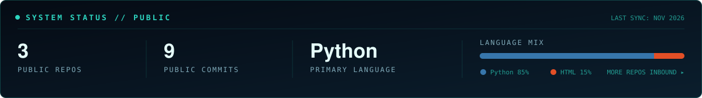

# Hi, I'm Desmond 👋

Security engineer · Builder of tools that make security work less tedious

I work on network and system security, with a focus on **boundary security architecture** and **network segmentation & zero trust**. Outside of work I build homelab gear, RF projects, and small utilities I wish already existed.

---

### 🔐 What I Work On
- Boundary security & network access control
- Network traffic analysis & packet capture (Wireshark, tcpdump, Zeek)
- Compliance hardening & continuous monitoring
- Endpoint security & vulnerability management
- Raspberry Pi / RF / wireless security labs

### 🛠️ Projects
| Project | What it does |
|---|---|
| [**TIDY//OS**](https://github.com/ShadowHertz/tidy-os) | Python utility that sorts files and labels Gmail automatically |
| [**Signal Mesh**](https://github.com/ShadowHertz/sec-wallpapers) | Interactive particle-network desktop wallpaper with a live clock, for Lively / Wallpaper Engine |
| **Sentinel** *(writeup coming)* | Raspberry Pi 4 cyberdeck for RF/wireless scanning, with a hardened Linux and SSH setup |

### 📜 Certifications

🎓 B.S. Cybersecurity & Information Assurance *(in progress)*
📚 Currently studying for: **Forescout Certified Associate (FSCA)**

### 🧰 Tools & Tech

---

*All projects here are personal, built on my own time and equipment, and use only public information.*
